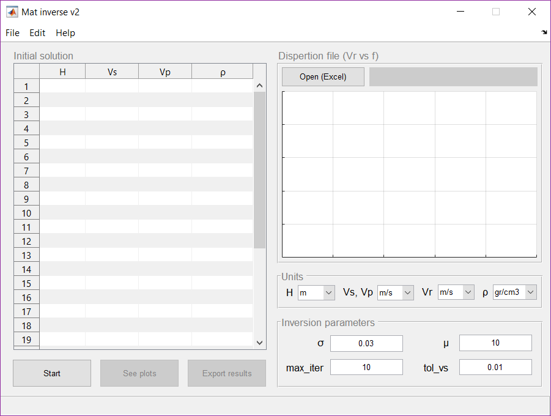

<h1 align="center">mat-inverse v2</h1>

Matlab code for inversion of Rayleigh phase velocity, with a GUI and new options

 

	

Initially built from <a href="https://github.com/yiran06/mat_inverse">mat_inverse</a> and <a href="https://github.com/yiran06/mat_disperse">mat_disperse</a> matlab libraries, in this new version a GUI is added, and some minimal changes to perform the invertion of Raylegh phase velocity.

## License

This project is licensed under GPLv2 [https://www.gnu.org/licenses/old-licenses/gpl-2.0.html]

## Author

[Pablo Pizarro R.](https://ppizarror.com) | 2016 - 2019
